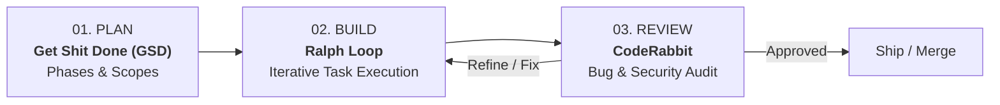

# ANTIGRAVITY • 3 Essential Skills
## The Practical Setup Guide for AI-Assisted Web Development

This repository integrates the **3-Skill Workflow** for AI-assisted engineering with Google Antigravity:



---

## 01 • GET SHIT DONE (GSD)
### Break Big Projects into Clear, Manageable Work

GSD turns large development goals into structured phases and smaller tasks so an AI coding agent has clearer context and a reliable workflow without context degradation.

* **Official Repository:** [github.com/toonight/get-shit-done-for-antigravity](https://github.com/toonight/get-shit-done-for-antigravity)
* **Local Location:** `.agents/skills/`, `.agent/workflows/`, `PROJECT_RULES.md`, `GSD-STYLE.md`

### Core Skills Installed
* `planner`: Formulates phased roadmaps and milestone specifications.
* `executor`: Executes bounded, deterministic task units.
* `verifier`: Verifies acceptance criteria and builds before moving to the next milestone.
* `codebase-mapper`: Indexes architecture and symbol hierarchies.
* `debugger`: Root-cause analysis and surgical hotfixes.

### Lifecycle Workflow
```
/new-project  →  /discuss-phase  →  /plan  →  /execute  →  /verify
```

1. **/new-project**: Define high-level goals, stack, constraints, and requirements.
2. **/discuss-phase**: Align on architecture, tradeoffs, and design decisions before writing code.
3. **/plan**: Break the phase into discrete, testable sub-tasks.
4. **/execute**: The agent writes the code for that phase only.
5. **/verify**: Validates build targets (`npm run build`) and acceptance tests.

---

## 02 • RALPH LOOP
### Let an Agent Repeatedly Work Through Defined Tasks

Ralph-style workflows repeatedly run an AI agent against a task list or PRD, using project state and progress files to continue the work between iterations.

* **Antigravity Extension:** [github.com/abhishekbhakat/ralph-loop-for-antigravity](https://github.com/abhishekbhakat/ralph-loop-for-antigravity)
* **Alternative CLI:** [github.com/iannuttall/ralph](https://github.com/iannuttall/ralph) (`npm i -g @iannuttall/ralph`)

### How to Write Effective Tasks
Avoid vague, unbounded tasks like *"Build the website"*. Use specific, deterministic tasks with explicit definitions of done:
* ✔️ *"Create the hero section, make it responsive, run the build with 'npm run build', and fix any build errors."*
* ✔️ *"Add WhatsApp click-to-chat action in PropertyEnquiryModal with prefilled property title and code."*

### Setup Checklist
1. Install the Ralph Loop extension or CLI.
2. Prepare a `PRD.md` or `TASKS.md` with checkable items (`- [ ]`).
3. Select the task file, progress file, and set an iteration limit (e.g. 5–10).
4. Run the loop and inspect diffs between cycles.

---

## 03 • CODERABBIT
### Catch Bugs and Code-Quality Issues Earlier

CodeRabbit reviews code and helps identify bugs, performance regressions, and security vulnerabilities.

* **Official Portal:** [coderabbit.ai](https://coderabbit.ai)
* **Official Skills Repo:** [github.com/coderabbitai/skills](https://github.com/coderabbitai/skills)
* **Documentation:** [docs.coderabbit.ai/cli](https://docs.coderabbit.ai/cli)
* **Installed Locally In:** `.agents/skills/code-review` and `.agents/skills/autofix`

### Review Commands
```powershell
# Review uncommitted changes in current working tree
coderabbit review --agent --uncommitted

# Review against main branch
coderabbit review --agent --base main

# Review a specific directory
coderabbit review --agent --dir src/pages
```

> [!CAUTION]
> **Security Reminder:** Never intentionally send API keys, passwords, private tokens, or secrets for review. Keep `.env` files untracked.

---

## THE 3-SKILL PIPELINE IN PRACTICE

| Step | Tool | Responsibility | Output |
| :--- | :--- | :--- | :--- |
| **1. Plan** | **Get Shit Done (GSD)** | Scope feature boundaries, architecture & rules | `PLAN.md`, Phase Specs |
| **2. Build** | **Ralph Loop** | Loop through bounded tasks autonomously | Code changes, passing builds |
| **3. Review** | **CodeRabbit** | Automated second pair of eyes | Review diff, quality audit |
